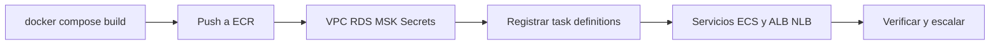

# Pasos para desplegar el sistema en un entorno de nube

Este documento describe cómo llevar XYZ Bank a **AWS** usando **ECS Fargate**, a partir de las plantillas ya incluidas en el repositorio (`deploy/aws/`). Esas plantillas **no crean recursos**: hay que aprovisionar la infraestructura, registrar las task definitions y levantar los servicios.

Referencia detallada de placeholders, secretos y pendientes: [deploy/aws/README.md](deploy/aws/README.md). Script de imágenes: [scripts/push-images-to-ecr.sh](scripts/push-images-to-ecr.sh).



---

## 1. Arquitectura objetivo

```
                    Internet
                       |
        ALB (HTTPS, certificado ACM)            NLB (TCP 8083, TLS passthrough)
        /                        \                     |
   bff-web (8081)          bff-mobile (8082)       bff-atm (8083, terminales mTLS)
        \______________________|_______________________/
                               | subredes privadas, namespace Cloud Map xyz-bank.local
                         api-gateway (8090)
        ____________________|______________________________________
        |            |              |               |              |
  core-service  customers-    payments-       interests-     auth-server (9000)
   (8080/8453)   service        service         service
        |            |              |               |              |
        +---- RDS PostgreSQL ------+          MSK (Kafka)     RDS PostgreSQL (auth)
        config-server (8888)   eureka-server (8761)       RDS MySQL (job data-migration)
```

- **Tráfico público:** solo `bff-web`, `bff-mobile`, `bff-atm` y `auth-server` (login, JWKS).
- **ALB:** termina TLS (ACM) hacia web y mobile.
- **NLB:** TCP 8083 con TLS passthrough para el mTLS de los terminales ATM.
- **Descubrimiento:** Eureka sigue registrando instancias; los nombres internos usan Cloud Map (`<servicio>.xyz-bank.local`).
- **Datos:** RDS PostgreSQL compartida (`core_service`, un esquema por servicio) + instancia aparte para `auth_server`; RDS MySQL para `data-migration`.
- **Mensajería:** Amazon MSK (sustituye el Kafka local). Hay que crear los tópicos y sus `.DLT` (3 particiones).
- **Secretos:** Secrets Manager (`xyz-bank/<VARIABLE>`), referenciados en las task definitions. Ninguna contraseña va en el JSON.

Task definitions incluidas (`deploy/aws/task-definitions/`):

`config-server`, `eureka-server`, `api-gateway`, `core-service`, `customers-service`, `payments-service`, `interests-service`, `auth-server`, `bff-web`, `bff-mobile`, `bff-atm`, `data-migration`.

---

## 2. Herramientas y permisos

| Herramienta | Uso |
|---|---|
| AWS CLI v2 | Crear y operar recursos |
| Docker + buildx | Imágenes `linux/amd64` (Fargate X86_64) |
| `jq` | Validar task definitions |
| `envsubst` (paquete gettext) | Sustituir `${...}` en las plantillas |
| Cuenta AWS | Permisos sobre ECR, ECS, EC2/VPC, RDS, MSK, IAM, Secrets Manager, ELB, CloudWatch, Service Discovery |

Comprueba:

```bash
aws --version
docker buildx version
jq --version
envsubst --version
aws sts get-caller-identity
```

---

## 3. Variables del despliegue

Exporta (o guarda en un archivo que sources) antes de registrar task definitions:

```bash
export AWS_ACCOUNT_ID=123456789012
export AWS_REGION=us-east-1
export ECR_REGISTRY="${AWS_ACCOUNT_ID}.dkr.ecr.${AWS_REGION}.amazonaws.com"
export TAG=1.0.0

export RDS_POSTGRES_HOST=xyz-bank-pg.xxxxx.rds.amazonaws.com
export RDS_AUTH_POSTGRES_HOST=xyz-bank-auth-pg.xxxxx.rds.amazonaws.com
export RDS_MYSQL_HOST=xyz-bank-mysql.xxxxx.rds.amazonaws.com
export MSK_BOOTSTRAP_SERVERS=b-1.xxx.kafka.us-east-1.amazonaws.com:9092,...

export AUTH_PUBLIC_ISSUER=https://auth.ejemplo.com
export BFF_WEB_PUBLIC_URL=https://web.ejemplo.com
export BFF_MOBILE_PUBLIC_URL=https://mobile.ejemplo.com
```

| Placeholder | Significado |
|---|---|
| `${AWS_ACCOUNT_ID}`, `${AWS_REGION}` | Cuenta y región |
| `${ECR_REGISTRY}`, `${TAG}` | Registro ECR y tag de imagen |
| `${RDS_POSTGRES_HOST}`, `${RDS_AUTH_POSTGRES_HOST}`, `${RDS_MYSQL_HOST}` | Endpoints de bases |
| `${MSK_BOOTSTRAP_SERVERS}` | Brokers MSK |
| `${AUTH_PUBLIC_ISSUER}`, `${BFF_WEB_PUBLIC_URL}`, `${BFF_MOBILE_PUBLIC_URL}` | URLs HTTPS públicas |

---

## 4. Paso 1 — Red (VPC, subredes, Cloud Map)

1. Crea una VPC con al menos **2 zonas de disponibilidad**.
2. Subredes **públicas** (ALB/NLB, NAT) y **privadas** (tareas ECS, RDS, MSK).
3. Grupos de seguridad por capa:
   - ALB/NLB: 443 (y 8083 en NLB) desde Internet.
   - BFFs / auth-server: solo desde los balanceadores.
   - api-gateway y microservicios: solo desde la red interna / BFFs.
   - RDS y MSK: solo desde las tareas de aplicación.
4. Namespace de Service Discovery:

```bash
aws servicediscovery create-private-dns-namespace \
  --name xyz-bank.local \
  --vpc <VPC_ID> \
  --region "$AWS_REGION"
```

Las task definitions ya apuntan a nombres del estilo `<servicio>.xyz-bank.local`.

---

## 5. Paso 2 — ECR e imágenes

Crea un repositorio por servicio (el script de push **no** los crea):

```bash
SERVICES=(
  config-server eureka-server api-gateway core-service customers-service payments-service
  interests-service auth-server bff-web bff-mobile bff-atm data-migration
)

for s in "${SERVICES[@]}"; do
  aws ecr create-repository --repository-name "xyz-bank/${s}" --region "$AWS_REGION" || true
done
```

Construye para la arquitectura de Fargate (en Apple silicon usa `--platform`):

```bash
docker compose build --build-arg BUILDPLATFORM=linux/amd64
# o, según tu setup de buildx:
# docker compose build --platform linux/amd64

AWS_ACCOUNT_ID="$AWS_ACCOUNT_ID" AWS_REGION="$AWS_REGION" TAG="$TAG" \
  ./scripts/push-images-to-ecr.sh
```

---

## 6. Paso 3 — Datos (RDS)

1. **RDS PostgreSQL** para la plataforma: base `core_service` (o el nombre que usen las variables de entorno de las task definitions). Cada microservicio aplica Flyway sobre su propio esquema (`core`, `customers`, `payments`, `interests`).
2. **RDS PostgreSQL** aparte para `auth_server` (equivalente a `auth-postgres` en local).
3. **RDS MySQL** para el job `data-migration` (reportes de migración).
4. Coloca las instancias en subredes privadas; abre el puerto solo a los security groups de las tareas ECS.
5. Guarda host, usuario y contraseña en Secrets Manager (paso 5). Flyway crea el DDL al arrancar cada servicio: **no** hace falta migrar a mano.

---

## 7. Paso 4 — Kafka (Amazon MSK)

1. Crea un clúster MSK (KRaft o con ZooKeeper, según la versión que elijas) en las subredes privadas.
2. Anota los brokers de bootstrap → `${MSK_BOOTSTRAP_SERVERS}`.
3. Ejecuta una **tarea puntual** (o un job en un bastion) que cree los tópicos, igual que `kafka-init` en local:

| Tópico | Particiones |
|---|---|
| `interests.calculated` | 3 |
| `interests.calculated.DLT` | 3 |
| `interests.credit-results` | 3 |
| `interests.credit-results.DLT` | 3 |
| `transactions.confirmed` | 3 |
| `transactions.confirmed.DLT` | 3 |
| `security.alerts` | 3 |
| `security.alerts.DLT` | 3 |

Clave de partición en productores: `accountId`.

---

## 8. Paso 5 — Secretos, IAM y logs

### Secrets Manager

Crea un secreto por variable sensible, con nombre `xyz-bank/<VARIABLE>`. Ejemplos (valores de producción, no los de `.env.example`):

```bash
# Ejemplo: una variable
aws secretsmanager create-secret \
  --name xyz-bank/CORE_DB_PASSWORD \
  --secret-string 'REEMPLAZAR' \
  --region "$AWS_REGION"
```

Variables típicas alineadas con `.env.example` / Compose: `CORE_DB_PASSWORD`, `AUTH_DB_PASSWORD`, `MYSQL_PASSWORD`, `BFF_WEB_CLIENT_SECRET`, `BFF_MOBILE_CLIENT_SECRET`, `BFF_ATM_CLIENT_SECRET`, `BFF_ATM_SESSION_SECRET`, `INTERESTS_SERVICE_CLIENT_SECRET`, `CUSTOMERS_ADMIN_CLIENT_SECRET`, `ACCOUNTS_ADMIN_CLIENT_SECRET`, `PAYMENTS_ADMIN_CLIENT_SECRET`, `PAYMENTS_SERVICE_CLIENT_SECRET`, contraseñas de keystores TLS, etc.

Las task definitions referencian `secrets[].valueFrom` con ARN de Secrets Manager; **no** llevan `PASSWORD` ni `SECRET` en `environment`.

### Roles IAM

- `xyz-bank-ecs-execution`: pull de ECR, lectura de secretos, escritura en CloudWatch Logs.
- `xyz-bank-ecs-task`: permisos de la aplicación (si aplica: MSK, etc.).

### Log groups

```bash
for s in "${SERVICES[@]}"; do
  aws logs create-log-group --log-group-name "/ecs/xyz-bank/${s}" --region "$AWS_REGION" || true
done
```

---

## 9. Paso 6 — Material TLS

En local, los BFFs, `auth-server` y el conector de PIN de `core-service` leen keystores desde `file:/certs/...`. **Fargate no monta secretos como archivos**, así que hay que decidir cómo entregarlos. Opciones descritas en [deploy/aws/README.md](deploy/aws/README.md) (pendientes):

- Volumen **EFS** con los PKCS12.
- Contenedor **init** que descarga secretos a un volumen efímero.
- Terminar TLS en el **ALB** (ACM) para web/mobile y dejar el mTLS del ATM como diseño aparte (passthrough NLB).

Hasta resolver esto, las tareas que exigen keystore no arrancarán en producción. En desarrollo local sigue usándose `./scripts/generate-dev-tls-certs.sh`.

---

## 10. Paso 7 — Validar y registrar task definitions

Validación local (sin llamar a AWS):

```bash
for f in deploy/aws/task-definitions/*.json; do
  jq -e '.requiresCompatibilities == ["FARGATE"] and .networkMode == "awsvpc"
    and (.containerDefinitions[0].image | startswith("${ECR_REGISTRY}/xyz-bank/"))
    and .containerDefinitions[0].logConfiguration.logDriver == "awslogs"
    and ((.containerDefinitions[0].healthCheck | type) == "object" or .family == "xyz-bank-data-migration")
    and ([.containerDefinitions[].environment[] | select(.name | test("PASSWORD|SECRET"))] | length == 0)
    and ([.containerDefinitions[].secrets[]? | .valueFrom | startswith("arn:aws:secretsmanager:")] | all)' "$f" > /dev/null \
    && echo "ok  $f" || echo "BAD $f"
done
```

Registro (con las variables de la sección 3 exportadas; los roles y log groups deben existir):

```bash
for f in deploy/aws/task-definitions/*.json; do
  envsubst < "$f" | aws ecs register-task-definition --cli-input-json file:///dev/stdin
done
```

---

## 11. Paso 8 — Cluster ECS, servicios y balanceadores

1. Crea el cluster ECS (Fargate) y asocia las subredes privadas / security groups.
2. Orden de arranque recomendado (respeta dependencias de health y discovery):

   1. `config-server`
   2. `eureka-server`
   3. `auth-server`
   4. `core-service`, `customers-service`, `payments-service`, `interests-service`
   5. `api-gateway`
   6. `bff-web`, `bff-mobile`, `bff-atm`

3. **data-migration:** no es un servicio permanente. Ejecútalo una vez (o en releases de datos) con `aws ecs run-task` usando la familia `xyz-bank-data-migration`, después de que MySQL esté listo.
4. **ALB:** listeners HTTPS 443 → target groups de `bff-web` (8081) y `bff-mobile` (8082); certificado ACM. Rutas DNS → `BFF_WEB_PUBLIC_URL` / `BFF_MOBILE_PUBLIC_URL`.
5. **NLB:** listener TCP 8083 → `bff-atm` (passthrough TLS).
6. Expón `auth-server:9000` (ALB o NLB según diseño) y alinea `AUTH_PUBLIC_ISSUER` con esa URL pública.
7. Registra cada servicio ECS en Cloud Map / Eureka según lo que indiquen las task definitions.

Ejemplo esquemático de creación de un servicio (ajusta red y task definition):

```bash
aws ecs create-service \
  --cluster xyz-bank \
  --service-name core-service \
  --task-definition xyz-bank-core-service \
  --desired-count 2 \
  --launch-type FARGATE \
  --network-configuration "awsvpcConfiguration={subnets=[subnet-aaa,subnet-bbb],securityGroups=[sg-xxx],assignPublicIp=DISABLED}" \
  --region "$AWS_REGION"
```

---

## 12. Paso 9 — Autoscaling

Objetivo: CPU promedio ~60 %. Mínimo **2** tareas para `core-service`, `customers-service`, `payments-service`, `api-gateway` y los BFFs. `config-server` y `eureka-server` pueden quedarse en 1 (o 2 por disponibilidad).

```bash
# Registrar el recurso escalable (ejemplo core-service)
aws application-autoscaling register-scalable-target \
  --service-namespace ecs \
  --scalable-dimension ecs:service:DesiredCount \
  --resource-id service/xyz-bank/core-service \
  --min-capacity 2 --max-capacity 6 \
  --region "$AWS_REGION"

aws application-autoscaling put-scaling-policy \
  --service-namespace ecs \
  --scalable-dimension ecs:service:DesiredCount \
  --resource-id service/xyz-bank/core-service \
  --policy-name xyz-bank-core-cpu-60 \
  --policy-type TargetTrackingScaling \
  --target-tracking-scaling-policy-configuration '{
    "TargetValue": 60.0,
    "PredefinedMetricSpecification": {
      "PredefinedMetricType": "ECSServiceAverageCPUUtilization"
    },
    "ScaleInCooldown": 300,
    "ScaleOutCooldown": 60
  }' \
  --region "$AWS_REGION"
```

Los servicios no guardan estado en memoria: el outbox usa `SKIP LOCKED` y los consumidores Kafka son idempotentes por `eventId`, así que escalar es seguro.

---

## 13. Paso 10 — Verificación post-despliegue

1. Health de los BFFs y `auth-server` por las URLs públicas (HTTPS).
2. Login demo o real contra `AUTH_PUBLIC_ISSUER` (ojo: en producción no dejes `AUTH_DEMO_PASSWORD` si no corresponde).
3. Flujo ATM contra el NLB (certificado de terminal de prueba).
4. Colección Postman apuntando a las URLs públicas (ajusta variables de base URL y certificados).
5. Logs en CloudWatch: `/ecs/xyz-bank/<servicio>`.
6. Confirma en Eureka / Cloud Map que hay al menos el `desired-count` de instancias UP.

---

## 14. Observabilidad en AWS

- **Logs:** ya van a CloudWatch (`awslogs`) desde las task definitions.
- **Métricas:** cada servicio expone `/actuator/prometheus` en el puerto interno. Opcional: Amazon Managed Service for Prometheus o un collector.
- **Trazas:** muestreo ~10 % en las plantillas; collector OpenTelemetry o Zipkin autoalojado (no incluido en los JSON de este repo).

---

## 15. Limitaciones y pendientes

Documentados en [deploy/aws/README.md](deploy/aws/README.md):

- Entrega de **keystores TLS** a Fargate (EFS / init / rediseño ACM).
- **mTLS ATM** de punta a punta (passthrough NLB) descrito, no cerrado en diseño operativo.
- Usuario **demo** (`AUTH_DEMO_PASSWORD`) no debería existir en producción.
- `config-server` empaqueta `config-repo/` en la imagen: un cambio de config exige **rebuild + push + redeploy**.
- Este directorio **no aprovisiona** VPC, ECR, ECS, ALB/NLB, RDS, MSK, roles ni secretos: hay que crearlos (pasos 1–8).

---

## 16. Alternativa simple (demo en la nube)

Si solo necesitas una demo rápida sin Fargate:

1. Lanza una **EC2** (Amazon Linux / Ubuntu) con Docker y Compose.
2. Clona el repo, genera certificados, copia `.env`.
3. Usa **`docker-compose.yaml` sin el override** de desarrollo (menos puertos expuestos; solo BFFs y auth-server de cara al exterior).
4. Abre security groups a 8081, 8082, 8083 y 9000 (y 443 si pones un reverse proxy).
5. Apunta un DNS o IP pública a esa máquina.

Esto no reemplaza el diseño ECS (alta disponibilidad, autoscaling, MSK/RDS gestionados), pero permite demostrar el stack completo con el mismo Compose que en local.

---

## Resumen de checklist

- [ ] VPC, subredes, security groups, Cloud Map `xyz-bank.local`
- [ ] Repositorios ECR + `push-images-to-ecr.sh`
- [ ] RDS PostgreSQL (plataforma + auth) y RDS MySQL
- [ ] MSK + tópicos y `.DLT` (3 particiones)
- [ ] Secrets Manager + roles IAM + log groups
- [ ] Estrategia TLS para Fargate
- [ ] `envsubst` + `register-task-definition` para las 12 familias
- [ ] Servicios ECS en orden + ALB/NLB + `run-task` de migración
- [ ] Autoscaling (CPU 60 %, min 2 donde corresponde)
- [ ] Verificación funcional y logs
